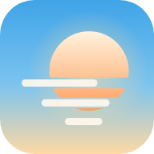
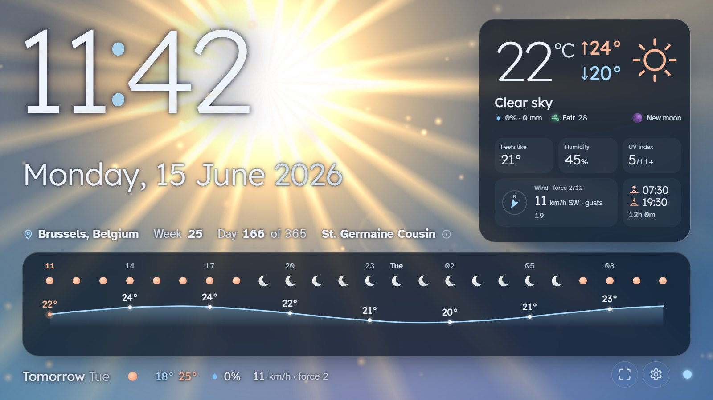
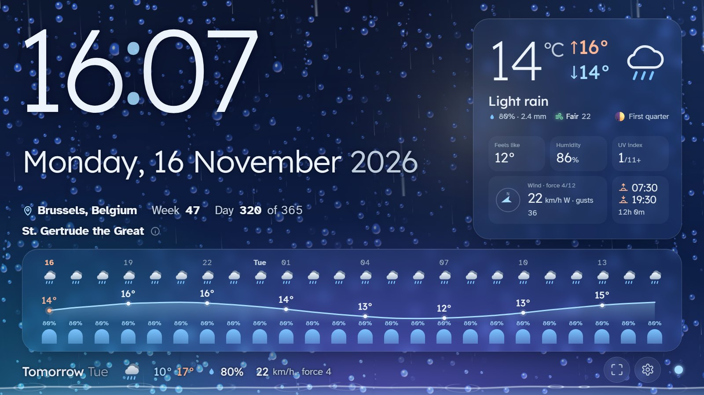
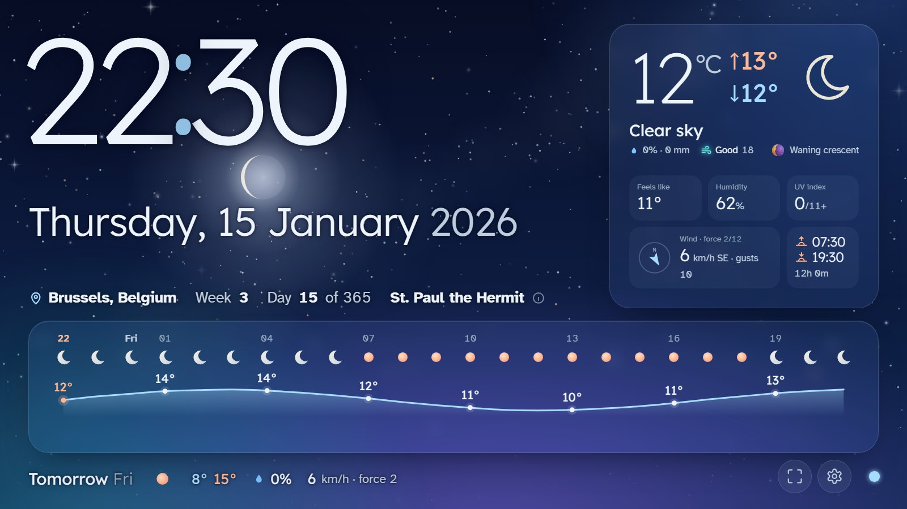
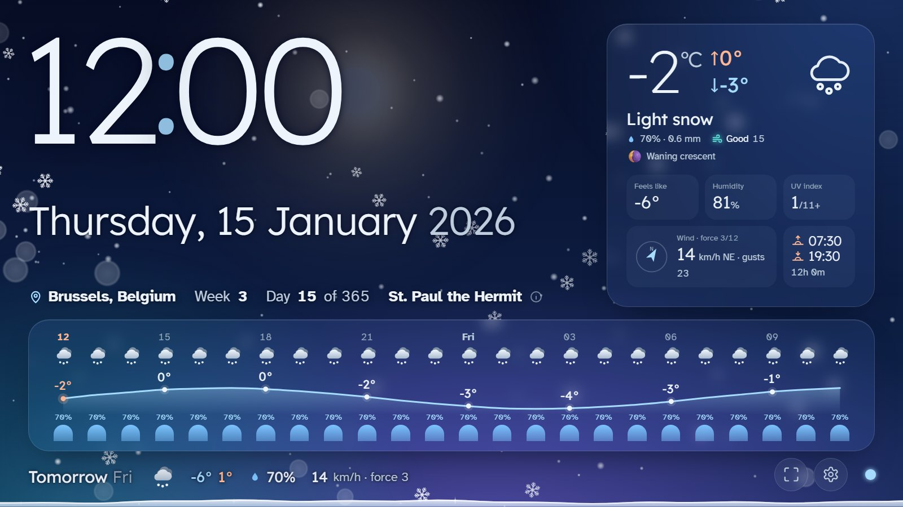
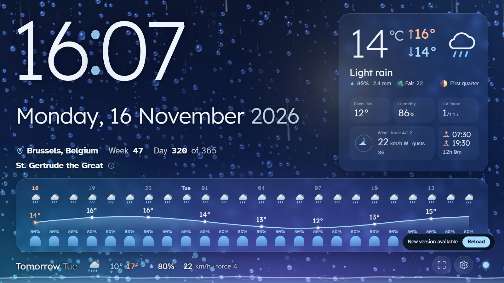
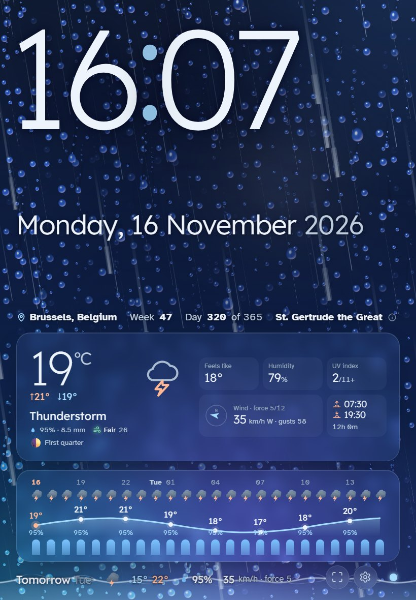

<p align="center">
  
</p>

<h1 align="center">Weather Dash</h1>

<p align="center"><strong>A weather and date wall display that is made to stay on, all day, in any room.</strong></p>

<p align="center">
  <a href="https://github.com/LightSeek3r/weather-dash/actions/workflows/ci.yml"></a>
  <a href="LICENSE"></a>
  <a href="https://github.com/LightSeek3r/weather-dash/releases/latest"></a>
  
  
</p>

<p align="center">
  <a href="https://weather.unit42.fr"><strong>Open the app</strong></a> ·
  <a href="CHANGELOG.md">Changelog</a> ·
  <a href="#running-it-as-a-wall-display">Wall display setup</a> ·
  <a href="https://github.com/LightSeek3r/weather-dash/issues">Report an issue</a>
</p>

<p align="center">
  
</p>

Weather Dash turns any screen (a tablet on the wall, a TV, an old phone on a desk) into a calm,
legible weather and date display. A big clock and the date sit directly on a sky that moves with
the real weather; the current conditions and the next 24 hours sit on frosted-glass cards. It runs
in the browser, works offline once loaded, installs as an app, and keeps everything (your place,
your settings, your photos) on your own device. No account, no ads, no tracking.

**Part of [Unit42](https://unit42.fr).** Built and maintained by
[LightSeek3r](https://github.com/LightSeek3r). This README is for people who want to run, read or
contribute to the code; the app itself is at <https://weather.unit42.fr>.

- [Highlights](#highlights)
- [Screenshots](#screenshots)
- [Running it as a wall display](#running-it-as-a-wall-display)
- [Getting started](#getting-started)
- [Tech stack](#tech-stack) · [Project structure](#project-structure) · [Testing](#testing)
- [Deployment](#deployment) · [Versioning](#versioning) · [Privacy](#privacy)
- [Contributing](#contributing) · [Licence and credits](#licence-and-credits)

## Highlights

- **Built for 24/7.** Pixel shift and an anti-burn-in scene for OLED panels, a night dim, a screen
  wake lock, an automatic reload every night at 03:30, and a status dot that tells you when the data
  is stale or the device is offline.
- **A sky that follows the weather.** Sun, moon and stars travel on a real arc; clouds, rain, snow,
  fog, ice and lightning are drawn around the screen and drift in front of and behind the
  glass. Effects scale to the device, and reduced motion is respected.
- **Everything you glance at, nothing you don't.** Temperature with the rest-of-day high and low,
  feels-like, humidity, UV index, wind force with a compass, air quality, sunrise and sunset, the
  moon phase, a scrollable 24-hour strip and tomorrow at a glance.
- **Date, holidays and saints.** Week and day of the year, public and bank holidays for your
  country and region (plus extra countries), and the saint of the day (Roman Catholic or French
  civil calendars).
- **Your own photos.** Import pictures from the device; they rotate behind the glass with a slow
  Ken Burns drift and a dim slider. They are stored in the browser and never uploaded.
- **15 languages**, including right-to-left Arabic and Urdu, with natural condition phrases rather
  than word-for-word translations.
- **Installable and offline.** A service worker caches the app, the last forecast is kept for
  offline boots, and when a new version is ready the status dot becomes a **Reload** invitation.
- **Never loses content on a small screen.** Layouts rearrange and resize from a phone in portrait
  to a 4K TV; they don't hide, clip or overlap what you need to read.

## Screenshots

<table>
  <tr>
    <td width="50%"></td>
    <td width="50%"></td>
  </tr>
  <tr>
    <td width="50%"></td>
    <td width="50%"></td>
  </tr>
</table>

<p align="center">
  
</p>

## Running it as a wall display

The app is a static PWA: build it once, host it anywhere (or use <https://weather.unit42.fr>), then
lock a device's browser onto that URL.

**Android tablet or TV**

- [Fully Kiosk Browser](https://www.fully-kiosk.com/): point it at the URL and enable *start on
  boot* and *kiosk lock*. The most robust option for an unattended device.
- Or plain Chrome: `chrome --kiosk <url>`.

**iPad**

- Open the URL in Safari, then **Share → Add to Home Screen**. The manifest asks for
  `display: fullscreen`, and the app's own tap-to-start gesture requests the Fullscreen and Wake
  Lock APIs.
- To lock the device to the app, turn on **Settings → Accessibility → Guided Access** and
  triple-click the side or home button once the app is open.

**Desktop or digital-signage box**

- Chrome or Edge: `chrome --kiosk <url>` or `msedge --kiosk <url>`.
- Any signage player that can open a URL works, since this is a plain web app.

Everything else (place, units, language, holidays, saints, photos, reduced motion) is in the
settings sheet behind the gear button: no separate provisioning step before locking the browser down.

## Getting started

Requires Node 22 or later.

```bash
npm install
npm run dev        # http://localhost:5173
npm run build      # production build in dist/
npm run preview    # serve the production build
```

| Script | What it does |
| --- | --- |
| `npm run dev` | Vite dev server |
| `npm run build` | Production build, including the service worker |
| `npm run lint` | ESLint |
| `npm run check` | svelte-check (0 errors is the bar) |
| `npm test` | Unit tests (Vitest) |
| `npm run test:e2e` | End-to-end tests (Playwright; run `npx playwright install` once) |
| `npm run format` | Prettier |

Debug URL parameters make any state reproducible: `?freeze=1`, `?now=2026-01-15T12:00:00`,
`?weather=clear-day|clear-night|rain|snow|fog|storm`, and `?update=1` to see the new-version
invitation without a real service worker.

## Tech stack

| Need | Choice |
| --- | --- |
| Framework | Svelte 5, TypeScript, Vite |
| PWA | vite-plugin-pwa (service worker, manifest, update prompt) |
| Settings | valibot (versioned, migrated schema), persisted in the browser |
| Photos and cached data | idb-keyval (IndexedDB) |
| Holidays | date-holidays (offline, multi-country and region) |
| Weather, air quality, geocoding | [Open-Meteo](https://open-meteo.com/) (keyless) |
| Place names | OpenStreetMap Nominatim (reverse geocoding) |
| Effects | Canvas 2D and WebGL, drawn from scratch |
| Tests | Vitest (unit), Playwright (end-to-end and visual) |

## Project structure

```
src/
  App.svelte            composition root, kiosk start and wake lock
  components/           clock, date line, weather card, 24h timeline, tomorrow strip,
                        status dot, settings sheet, popovers, install banner
  lib/
    core/               scheduler, night mode, pixel shift, nightly reload, app update, settings storage
    date/               calendar, holidays, saints
    weather/            Open-Meteo client, snapshot store and cache, condition mapping, moon, units
    fx/                 the weather effects and the glass-card cut-outs
    photos/             import, storage, rotation
    ui/                 strings (15 languages), formatting, fit-to-height
functions/api/geo.ts    Cloudflare Pages Function: approximate location from the edge's IP geolocation
tests/                  unit/ (Vitest), e2e/ and visual/ (Playwright)
```

## Testing

```bash
npm test                                          # unit
npm run test:e2e                                  # end-to-end, all browsers
npx playwright test --project=chromium            # end-to-end, Chromium only (what CI runs)
npx playwright test --project=visual --update-snapshots   # create your local visual baselines
```

The visual suite (`tests/visual`) screenshots a matrix of weather states and screen sizes. Its
baselines depend on the operating system, so they are not committed: generate yours once, then
run the suite to catch visual regressions.

## Deployment

Deployed on **Cloudflare Pages**: a push to `main` builds and publishes <https://weather.unit42.fr>.

| Setting | Value |
| --- | --- |
| Build command | `npm run build` |
| Build output directory | `dist` |
| Node version | `22` (environment variable `NODE_VERSION`) |
| Functions | `functions/` is picked up automatically (`/api/geo`) |

Any static host works too; without Pages Functions the "approximate location" fallback in the
settings sheet is simply unavailable.

## Versioning

[Semantic Versioning](https://semver.org), loosely while the project is 0.x; every release is a
`vX.Y.Z` tag with a [GitHub release](https://github.com/LightSeek3r/weather-dash/releases) whose notes
come from [CHANGELOG.md](CHANGELOG.md). The running version is shown at the bottom of the settings
sheet. To cut a release: move the `Unreleased` entries under a new version heading, bump
`version` in `package.json`, commit, and push a `v*` tag: the release workflow publishes it.

## Privacy

Your settings, location and photos are stored in your browser (localStorage and IndexedDB) and
never sent anywhere. The only requests the app makes are to Open-Meteo (weather, air quality, place
search, with your coordinates) and, to name a place, OpenStreetMap Nominatim; the optional
approximate-location fallback asks the app's own `/api/geo`. No analytics, no cookies, no account.

## Contributing

Issues and pull requests are welcome; see [CONTRIBUTING.md](CONTRIBUTING.md) and the
[Code of Conduct](CODE_OF_CONDUCT.md). Security problems go through [SECURITY.md](SECURITY.md).

## Licence and credits

[MIT](LICENSE) © 2026 LightSeek3r.

Weather data © [Open-Meteo.com](https://open-meteo.com/) (CC BY 4.0). Place names © OpenStreetMap
contributors (ODbL). Typefaces: Lexend and Atkinson Hyperlegible (SIL OFL), self-hosted. See
[NOTICE](NOTICE).
