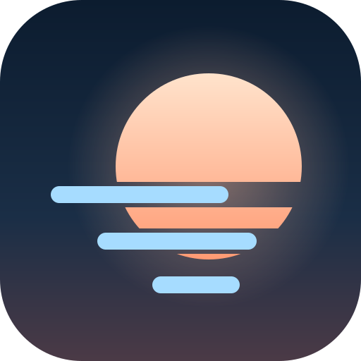

# Weather Dash

**Live:** https://weather-dash-9j2.pages.dev/

Fullscreen 24/7 weather and date wall display for phones, tablets, and TVs. Local-first settings, beautiful dark visuals with weather-driven effects, and anti-burn-in. Built with Svelte 5, TypeScript, Vite, and PWA technology.

**Features:**

- Responsive fullscreen layout (phone, tablet, desktop, TV)
- Real-time weather from Open-Meteo with dynamic background FX
- Local date/time with holidays and saints
- Local photos with intelligent rotation and Ken Burns effect
- Settings persisted to IndexedDB
- Offline-capable Progressive Web App
- Accessibility first (WCAG AA, reduced motion support)

## Getting Started

```bash
npm install
npm run dev       # Start dev server on http://localhost:5173
npm run build     # Production build
npm run preview   # Preview production build
```

## Scripts

- `npm run dev` - Start development server
- `npm run build` - Build for production
- `npm run preview` - Preview production build
- `npm run test` - Run unit tests (Vitest)
- `npm run test:e2e` - Run end-to-end tests (Playwright)
- `node scripts/brand-assets.mjs` - Regenerate icons, OG image and install screenshots in `public/` from `public/favicon.svg` (needs `npm run dev` running)
- `npm run lint` - Lint code (ESLint)
- `npm run format` - Format code (Prettier)

## Tech Stack

- **Framework:** Svelte 5 + Vite
- **Language:** TypeScript
- **Testing:** Vitest (unit), Playwright (E2E)
- **Linting:** ESLint + Prettier
- **PWA:** vite-plugin-pwa
- **Data:** valibot, idb-keyval, date-holidays
- **Weather:** Open-Meteo API

## Running as a 24/7 wall display

The app is a static PWA — build it once, host it anywhere, then lock a
device's browser onto that URL.

### 1. Build and host

```bash
npm run build     # outputs dist/
```

This repo is set up to deploy to **Cloudflare Pages** (per the build plan).
Once the repo owner connects it in the CF Pages dashboard, every push to the
main branch gets a stable `https://<project>.pages.dev` URL — that's the URL
each wall device below points at. No deploy credentials are needed on the
device itself, just the final URL.

### 2. Kiosk mode per device

**Android tablet/TV:**

- [Fully Kiosk Browser](https://www.fully-kiosk.com/) — install it, point it
  at the deployed URL, and enable its "start on boot" + "kiosk lock" options.
  This is the most robust option for an unattended device (auto-restart on
  crash, screen-off scheduling, etc.).
- Or plain Chrome from the command line: `chrome --kiosk <url>`.

**iPad:**

- Open the deployed URL in Safari, then **Share → Add to Home Screen**. The
  manifest already sets `display: "fullscreen"` (see `vite.config.ts`), and
  the app's own tap-to-start gesture requests the Fullscreen + Wake Lock
  APIs, so launching from the home-screen icon gets close to a real kiosk
  without a status bar.
- To actually lock the device to this one app (block swipe-away, notifications,
  accidental taps to other apps), enable **Settings → Accessibility →
  Guided Access**, then triple-click the side/home button once the app is
  open to start a locked session.

**Desktop / dedicated digital-signage box:**

- Chrome or Edge: `chrome --kiosk <url>` / `msedge --kiosk <url>` launches
  fullscreen with no browser UI and no way to navigate away via mouse/keyboard
  shortcuts disabled by the OS.
- Any browser-based digital-signage player (the kind used for retail/lobby
  screens) that can be pointed at an arbitrary URL works too, since this is
  a plain web app with no native dependencies.

Whichever route, the on-device settings sheet (tap anywhere → gear icon)
covers everything else — location, holidays, saints, photos, and reduced
motion — no separate provisioning step is needed before locking the browser
down.

## License

MIT
